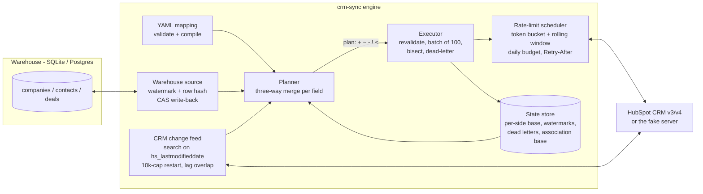
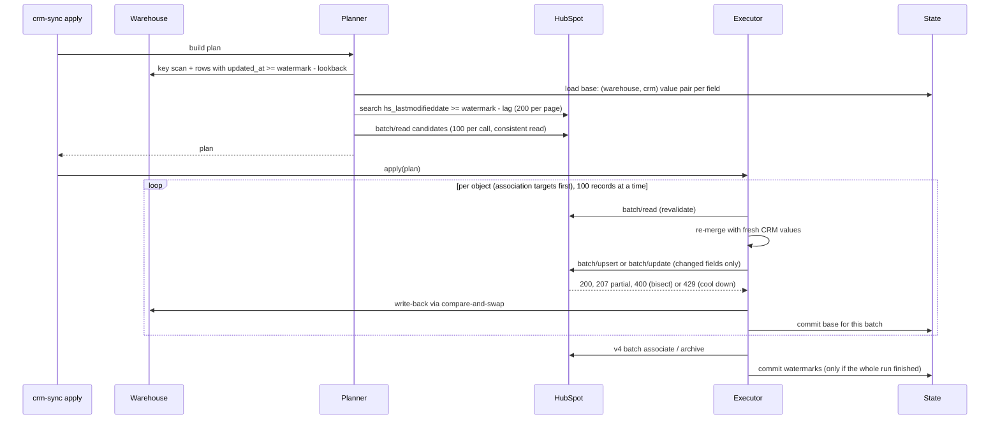

# crm-sync-engine

**A bi-directional reverse-ETL engine that keeps a SQL warehouse and HubSpot in sync. You declare
the mapping in YAML. Conflicts are resolved per field with a three-way merge, every change is
previewed as a terraform-style `plan` before `apply`, and convergence, idempotence and no-lost-update
guarantees are checked with property-based tests.**

```
$ crm-sync plan examples/mapping.yaml
# contacts
  ~ update    ava.khan5@mail5.example.com  (id 1024)
      ~ firstname              "Mr. Wrong" -> "Ava"   # source_wins: revert CRM drift
  ~ update    liam.garcia6@mail6.example.com  (id 1097)
      ~ firstname              "Liam" -> "Priyanka"
  < writeback mia.kim3@mail3.example.com  (id 1122)
      < phone                  warehouse "+12629486072" <- "+16465550142"
  ! keep      omar.okafor4@mail4.example.com  (id 1159)  (conflict resolved in favour of the CRM)
      ! lifecyclestage         conflict wh="customer" crm="opportunity" -> "opportunity" [crm_wins]
  + create    zara.okafor2@mail2.example.com
      + email                  = "zara.okafor2@mail2.example.com"
      + firstname              = "Zara"
      + lifecyclestage         = "lead"
  - archive   noah.khan8@mail8.example.com  (id 1139)  (row deleted in warehouse)

# associations contacts -> companies: +2 -0
Plan: 2 to create, 2 to update, 1 to archive, 1 field write-back(s), 1 conflict(s) resolved, 2 association(s) to add, 0 to remove.
```
<sub>Real output from the quickstart below against the fake HubSpot server (some create lines trimmed).</sub>

## Benchmark on real company data

`make bench-real` (`python bench/run_real_bench.py`) syncs **real companies with a real change
history**, not generated rows. Every number below is copied from
[`bench/results/real_bench.md`](bench/results/real_bench.md) /
[`real_bench.json`](bench/results/real_bench.json), which the script writes.

- **Data:** 11,564 companies from Wikidata (query.wikidata.org SPARQL, **CC0**, retrieved
  **2026-11-20**): companies that carry at least one dated headcount (P1128) or USD revenue
  (P2139) statement, with name, website/domain, country, HQ city, industry, founding year, plus
  22,322 dated headcount/revenue statements. Derived CSVs (~2 MB) are committed in
  [`bench/data/`](bench/data/); raw downloads are cached in `data/real/` (gitignored).
  Companies only: no contacts, no personal data.
- **Change stream:** the warehouse table is rebuilt "as of" each date from that dated history
  (a company exists from inception to dissolution and carries the latest published headcount and
  revenue). Initial load as of 2015-12-31, then one incremental sync per year-end 2016–2025 and
  one as of 2026-11-20: **12 runs, 16,855 real inserts/updates/deletes** after the initial load.
  Mapping: [`examples/mapping_real_companies.yaml`](examples/mapping_real_companies.yaml).
- **CRM side:** the fake HubSpot, enforcing Free/Starter limits (100 req/10 s, 5 searches/s) and
  injecting faults the whole time: 18 × 429, 9 × 5xx, 5 × committed-then-502, 4 timeouts
  (committed, response held past the 1 s client timeout) and 12 partial batch failures (207).

| Metric | Engine | Naive (1 request per record) |
|---|---:|---:|
| API calls, all 12 runs | **1,031** | **54,366** (52.7× more) |
| Initial load (10,328 companies) | 323 calls, 32.93 s at 100 req/10 s (313.6 records/s) | 20,656 calls; projected 1.51 h for all runs at 100 req/10 s |
| 429s seen / retries / dead-lettered then retried | 18 / 36 / 12 | n/a (no limits, no faults) |
| Server-side 429s from the real limits | 0 | n/a |
| Mismatches after convergence (11,082 rows × 10 fields) | **0** (0 missing, 0 duplicates, 0 orphans) | not checked |
| Idempotence: writes on two re-runs | **0, 0** (1 API call each) | n/a |

Unthrottled and fault-free, the same initial load took 5.07 s (2,037.1 records/s, 312 calls).
The naive baseline is generous: it is handed the exact delta for free and only lacks batching.

> **Honest scope.** The data and its history are real; the CRM is still the repo's **fake
> HubSpot**, which mimics the documented API and limits on localhost. API-call counts transfer to
> HubSpot, wall-clock times do not. The yearly replay comes from dated Wikidata statements, not
> from a real CRM's edit log, and only headcount, revenue and company existence change over time
> (names, websites and industries are today's values). No live HubSpot portal was used.

**Run it against your own HubSpot portal** (I have not done this; it needs your private-app
token with `crm.objects.companies.read` and `.write`, and two custom company properties,
`warehouse_id` (unique) and `wikidata_industry`). The token is read from the environment only:

```bash
python bench/run_real_bench.py --load-warehouse sqlite:///real_wh.db --as-of 2026-11-20
export WAREHOUSE_URL=sqlite:///real_wh.db STATE_URL=sqlite:///real_state.db \
       HUBSPOT_BASE_URL=https://api.hubapi.com
read -rs HUBSPOT_ACCESS_TOKEN && export HUBSPOT_ACCESS_TOKEN   # paste the token; never commit it
crm-sync plan  examples/mapping_real_companies.yaml            # read-only preview
crm-sync apply examples/mapping_real_companies.yaml            # writes ~11k companies to the portal
```

The older numbers in [section 6](#6-benchmarks-measured) are from **generated** records.

---

## 1. The problem

Revenue teams keep customer data in two systems that both believe they are the source of truth:

- **The warehouse** (Postgres, Snowflake, BigQuery) holds modelled data: product usage, billing,
  enrichment, lead scores.
- **The CRM** (HubSpot) is where sales reps actually work. They fix phone numbers, move lifecycle
  stages, and write job titles they heard on a call.

The usual glue is a nightly one-way reverse-ETL job or a Zapier-style flow. Both fail in the same
predictable ways:

| Symptom | Root cause |
|---|---|
| **Overwritten rep edits.** A rep corrects a phone number and it reverts overnight. | One-way sync with "warehouse always wins" and no memory of what changed where. |
| **Duplicate records.** The same person appears twice after a retry or a re-run. | Create-then-retry over a flaky network, with no idempotent key. |
| **Drift.** The CRM and the warehouse quietly disagree, and nobody knows which is right. | No change detection on the CRM side, so edits made there are invisible. |
| **Hitting the API wall.** Syncs take hours, then fail with 429s. | One HTTP request per record, against limits of 100 requests per 10 s and 250k per day. |
| **Silent data loss.** One bad email address fails a batch of 100. | HubSpot rejects the whole batch and does not say which record caused it. |

## 2. What I built

`crm-sync-engine` treats the sync as a distributed-systems problem with two replicas that are
eventually consistent. Each replica has its own writers and failure modes.

- **Declarative YAML mapping DSL.** Covers objects, match keys, field transforms in a small
  expression language that cannot execute code, per-field **direction** and **conflict policy**,
  and associations. It is validated up front, all errors are reported in one pass, each with a
  precise path and a "did you mean" hint.
- **Change detection on both sides.**
  - Warehouse: an `updated_at` watermark with a lookback window, plus a row-hash snapshot.
  - CRM: incremental search on `hs_lastmodifieddate` that works around HubSpot's 10,000-result
    paging cap and tolerates the eventually-consistent search index. Our own writes are filtered
    out when they come back through search ("echo suppression").
- **A field-level three-way merge** against a base snapshot stored *per side*, with five policies:
  `source_wins`, `crm_wins`, `latest_timestamp_wins`, `fill_if_empty`, `never_overwrite`.
- **`plan` / `apply`.** You see `+ ~ - ! <` before anything is written.
- **An executor built for HubSpot's real failure modes.**
  - Batch upserts and updates of 100 records, keyed on a unique property so writes are idempotent.
  - Every batch is re-read and re-merged just before the write, to narrow the lost-update window.
  - Partial batch failures are bisected so the bad records are isolated.
  - 207 responses are handled per item.
  - Failures go to a dead-letter store. `replay` re-plans the failed records against fresh data.
  - Warehouse write-backs use compare-and-swap.
  - v4 association sync.
- **A rate-limit scheduler.** A token bucket plus an exact rolling window per limit class, a
  daily budget, `Retry-After` handling, and adjustments from HubSpot's rate-limit headers.
- **A fake HubSpot server (FastAPI).** Every integration test and the benchmark run against it. It
  reproduces 429s, 5xx, "committed but the response was lost", whole-batch validation failures,
  207 partial errors, search lag, the 10k paging cap and property validation.

## 3. Architecture



One `apply`:



Code map:

| Module | Responsibility |
|---|---|
| `crm_sync/dsl/` | Pydantic models, validator and compiler for the mapping, plus the expression language (`expr.py`, `functions.py`) |
| `crm_sync/warehouse/source.py` | SQLAlchemy Core reads, row hashing, key and reference scans, CAS write-back |
| `crm_sync/crm/` | HubSpot client (batching, retries, bisection, 207 mapping, search paging) and the rate limiter |
| `crm_sync/engine/merge.py` | The pure three-way merge, `merge_field()` |
| `crm_sync/engine/planner.py`, `plan.py`, `render.py` | Change detection, the plan model, terraform-style output |
| `crm_sync/engine/executor.py` | Ordered, batched, revalidated, durable application of a plan |
| `crm_sync/state/store.py` | Base snapshots, watermarks, dead letters, association base |
| `fake_hubspot/` | The FastAPI fake portal (`hub.py` holds the behaviour, `app.py` the HTTP surface) |

## 4. Conflict model

Each mapped field has a **direction** and a **policy**. For every field, the engine keeps a base
pair `(base_wh, base_crm)`: what each side held after the last successful sync. With that it can
tell *who* changed a value, not just *that* the two sides differ.

| Situation (since the last sync) | Result |
|---|---|
| Record missing in the CRM | Create it from the warehouse |
| Only the warehouse changed | Push the warehouse value |
| Only the CRM changed | `bidirectional`: write it back to the warehouse. `to_crm`: keep the rep's value, except under `source_wins`, which reverts the drift |
| **Both changed, values differ (conflict, `!`)** | Resolved by the policy below |

| Policy | On conflict | Typical use |
|---|---|---|
| `source_wins` | Warehouse wins. With `to_crm` the warehouse is always enforced | IDs, plan tier, billing data |
| `crm_wins` | CRM wins. The rep's edit sticks until the warehouse changes that field *again* | Lifecycle stage, deal stage |
| `latest_timestamp_wins` | The newer record timestamp wins (warehouse `updated_at` vs HubSpot `hs_lastmodifieddate`); a tie goes to the warehouse | Phone numbers edited on both sides |
| `fill_if_empty` | Write only if the CRM field is empty | Enrichment such as job title or industry |
| `never_overwrite` | Set only when the record is created | First-touch attribution, close date |

Directions: `to_crm` (the default), `bidirectional`, and `to_warehouse` (the CRM owns the value and
the warehouse seeds it on create). Fields that write back may only use idempotent normalizer
transforms such as `lower(trim(value))` or `e164(value)`, so values cannot flip back and forth
between the two sides. The validator enforces this. The reasoning is in
[ADR 0001](docs/adr/0001-field-level-three-way-merge.md).

```yaml
- crm: phone
  warehouse: phone
  transform: "e164(value)"          # only registered functions; no eval
  direction: bidirectional
  policy: latest_timestamp_wins
- crm: lifecyclestage
  warehouse: lifecycle_stage
  transform: "lookup(value, 'lifecycle')"
  policy: crm_wins
```

## 5. Guarantees and how they are tested

There are **124 pytest tests**, including a Hypothesis state machine that runs random histories of
warehouse edits, rep edits, inserts, deletes, CRM-side deletions, flaky networks and *edits made
during a sync*. CI runs it with 25 examples on every PR and with 300 examples on `main`; a
300-example soak passed locally.

| Guarantee | Precise statement | Where it is checked |
|---|---|---|
| **Convergence** | Once edits stop and the search index catches up (within `search_lag_seconds`), one sync leaves every owned field (`source_wins`, or `bidirectional`) equal on both sides, associations matching the warehouse foreign keys, and deleted rows archived | `test_properties.py` (stateful invariant), `test_merge.py::test_owned_fields_converge`, the benchmark's independent `verify()` over all 50,000 rows |
| **Idempotence** | The plan computed right after a sync is empty: zero writes, zero state changes | Stateful invariant after every sync; `test_merge.py::test_applying_a_decision_is_idempotent` (all policies and directions); integration tests |
| **No duplicates** | Each match key maps to exactly one live CRM record, even across crashes, lost responses and retries | `test_crash_mid_apply_...`, `test_lost_response_retry_does_not_duplicate`, `test_flaky_network_still_converges`, a stateful invariant after every step |
| **No lost updates** (for the documented policies) | A rep edit to a `crm_wins` field is never discarded, including one made *after* planning. A non-empty `fill_if_empty` value is never clobbered. An edit to a field we are *not* writing survives at any moment. A concurrent warehouse edit beats a stale write-back (CAS) | `test_rep_edit_after_planning_is_not_lost`; `test_without_revalidation_the_same_race_loses_the_edit` (shows why revalidation exists); `test_edit_to_another_field_during_the_write_survives`; `test_concurrent_warehouse_edit_wins_over_stale_writeback`; the stateful `sync_with_concurrent_edit` rule |
| **Stays under rate limits** | The scheduler never exceeds the rolling limit, so it receives no 429s when the limits are configured correctly | `test_client_side_scheduler_prevents_429s`; throttled benchmark: 2,000 calls, **0** server 429s |
| **Partial-failure isolation** | One invalid record does not take down its batch | `test_bisection_isolates_poison_inputs`, `test_poison_record_dead_lettered_retried_then_replayed`, faults benchmark |

The documented window: HubSpot has no compare-and-swap. A rep edit to the **same field** that
lands between the revalidation read and the batch write (one round trip) can be overwritten. The
tests exclude exactly this window and name it explicitly. See
[ADR 0003](docs/adr/0003-change-detection-and-rate-limits.md).

The tests caught two real bugs during development:

1. **Hypothesis** found that a deal pointing at a contact deleted before the first sync produced
   an association that could never resolve, so every later plan re-proposed it. Associations are
   now diffed as sets and only against targets that exist.
2. **The rate-limit integration test** showed that a plain token bucket overshoots HubSpot's
   *rolling* 10-second window right after a burst. A rolling-window guard now fixes this.

## 6. Benchmarks (measured, generated data)

For the benchmark on real public company data, see
[Benchmark on real company data](#benchmark-on-real-company-data) at the top.

Command: `python bench/run_bench.py`. The run synced **50,000 generated records** (synthetic data
from `crm_sync/demo.py`: 5k companies, 40k contacts,
5k deals, and 50k associations) over real HTTP to the fake server on localhost. Client and server
shared one Python 3.11 process on a 2-vCPU Xeon VM. Raw output is in
[`bench/results/latest.json`](bench/results/latest.json) and the table in
[`bench/results/RESULTS.md`](bench/results/RESULTS.md).

> These are **fake-server results.** API **call counts** carry over to real HubSpot. **Wall-clock
> times** do not, because real HubSpot latency is far higher than localhost's. I have not run this
> against a real HubSpot portal.

| Scenario | API calls | Wall time | Result |
|---|---:|---:|---|
| Initial load into an empty CRM | **2,000** | 37.0 s (~1,350 records/s) | Independent check of all 50,000 rows: 0 mismatches, 0 duplicates, 50,000 associations |
| Same load, fake **enforcing HubSpot's 100 req/10 s + 5 search/s** | **2,000** | **204.5 s** | 0 server 429s; 0 mismatches |
| Naive baseline: 1 request per record and per association | **150,000** | 237.1 s unthrottled | **Projected 4.17 h** at 100 req/10 s, and 60% of a 250k/day quota |
| Re-run right after the load (our writes echo back through search) | 252 | 5.0 s | Every echo suppressed, nothing written |
| Steady-state no-op | **3** | 2.8 s | One search call per object |
| Incremental: 500 warehouse edits + 200 rep edits | 22 | 3.3 s | 500 updates sent; the 200 `crm_wins` rep edits kept; 0 mismatches |
| Faults: random 429s, 5xx, lost responses + 25 poison rows | 2,429 | 51.9 s | Injected 43 × 429, 28 × 5xx, 16 committed-then-502. 87 retries, 171 bisections. **Exactly the 25 poison rows dead-lettered**; the other 49,975 rows have 0 mismatches and 0 duplicates |

The takeaway on generated data: **75× fewer API calls** than one-request-per-record (2,000 vs
150,000). Under a
Free/Starter rate limit that is **about 3.4 minutes measured against a projected 4.2 hours**. On
average the batched path spends 4 calls per 100 records: a match read, a revalidation read, an
upsert and an association batch. Turning revalidation off would save a quarter of the calls, at the cost of
losing rep edits in the race described above.

## 7. Quickstart

```bash
python3.11 -m venv .venv && . .venv/bin/activate
pip install -e ".[dev]"
make check                                         # ruff + mypy --strict + pytest

# Terminal 1: fake HubSpot with real-ish limits and a 2 s search-index lag
fake-hubspot --port 8090 --rate-limit 100 --search-delay-ms 2000

# Terminal 2
export WAREHOUSE_URL=sqlite:///warehouse.db STATE_URL=sqlite:///state.db \
       HUBSPOT_BASE_URL=http://127.0.0.1:8090 HUBSPOT_ACCESS_TOKEN=local-dev-token
crm-sync validate examples/mapping.yaml
crm-sync demo-seed --contacts 200 --bad-rows 2      # 2 rows with an invalid lifecycle stage
crm-sync plan  examples/mapping.yaml
crm-sync apply examples/mapping.yaml                # 2 rows end up in the dead-letter queue
crm-sync dlq   examples/mapping.yaml
#  -> 400 VALIDATION_ERROR: zombie was not one of the allowed options: [...]
# fix the rows in the warehouse, then:
crm-sync replay examples/mapping.yaml
```

With Docker (Postgres warehouse, the fake server and the CLI):

```bash
docker compose up -d postgres fake-hubspot
docker compose run --rm sync demo-seed --contacts 2000
docker compose run --rm sync plan  examples/mapping.yaml
docker compose run --rm sync apply examples/mapping.yaml
```

For real HubSpot, set `HUBSPOT_BASE_URL=https://api.hubapi.com` and use a private-app token with
read and write scopes on contacts, companies and deals. Companies and deals match on a custom
**unique** property, `warehouse_id`, which you need to create in the portal first. `plan` never writes anything, so run it first.

Other commands: `crm-sync plan --json`, `--detailed-exitcode` (exit code 2 when there are changes,
useful in CI), `--full-refresh` (hash every row and re-scan the CRM). `make test-pg` runs the
integration suite against Postgres. It passes locally on Postgres 16, and the CI workflow has a
Postgres job for it. The Dockerfile and compose file are included but were not built here,
because no Docker daemon was available.

## 8. The fake HubSpot server

`python -m fake_hubspot` serves the v3 objects endpoints (batch read/upsert/update/archive, search,
and single-record CRUD) and v4 associations, plus a `/_admin` control plane for tests.

**Modelled:** a rolling 10 s limit and a daily limit, both answered with 429 + `Retry-After` and
`X-HubSpot-RateLimit-*` headers (none on search responses); 5 searches/s; max 200 results per
search page; 400 when paging past 10,000 results; a configurable search-index lag; a limit of 100
inputs per batch; whole-batch 400 on any invalid value; 207 for unknown ids; unknown, read-only,
enumeration, number, date, email and unique-value validation; lower-casing of emails and canonical
numbers; seeded random 429/5xx; "committed then 502"; timeouts (committed, response held back past
the client's timeout); 207 partial batch failures; an `Idempotency-Key` cache that is off by
default because real HubSpot has none.

**Limits checked against HubSpot's public docs on 2026-11-20:**
[usage guidelines](https://developers.hubspot.com/docs/developer-tooling/platform/usage-guidelines)
(private apps: Free/Starter 100 requests/10 s per app and 250,000/day per account; Professional
190/10 s and 625,000/day; Enterprise 190/10 s and 1,000,000/day; 429 body with `errorType`
`RATE_LIMIT`, `policyName`, `correlationId`, `requestId`; search responses carry no rate-limit
headers) and the
[CRM search reference](https://developers.hubspot.com/docs/api-reference/latest/crm/search-the-crm)
(5 requests/s per account, 200 objects per page, 10,000 results per query, 400 beyond that, a
short indexing delay). The limit values the repo used already matched; the check added `requestId` to the
429 body and a policy-specific 429 message. The 100-inputs batch limit was not restated on the
pages checked and is kept from the batch endpoint behaviour.

**Not modelled:** real latency, association labels, custom objects, property history, merges,
webhooks, and HubSpot-side defaults set on create.

## 9. Limitations

- **Validated against a fake server, not a live portal.** The fake follows HubSpot's documented
  limits and behaviours, but undocumented quirks will exist.
- `latest_timestamp_wins` compares **record-level** timestamps. A rep edit to field A makes the
  CRM look "newer" for field B as well.
- The residual same-field race between the revalidation read and the write (see section 5).
- If a match key changes (for example, an email changes in the warehouse), the engine archives the
  old record and creates a new one. It does not merge them.
- Records created by reps that have no warehouse row are not imported. CRM-side deletions are
  detected lazily, the next time the record becomes a sync candidate, and they are respected:
  the record is not recreated.
- Each run scans every warehouse key and association reference (cheap at about 10^5 rows, not at
  10^8). Right after a bulk load, the next run pages through its own echoes.
- One writer per portal. There is no distributed lock, and the executor does not dispatch batches
  in parallel.
- Only contacts, companies and deals with default association types. Tested on SQLite and
  Postgres 16, not on Snowflake or BigQuery.

## 10. Roadmap

1. HubSpot webhooks as the CRM change feed, with search kept as the reconciliation backstop.
2. Per-property timestamps (`propertiesWithHistory`) for `latest_timestamp_wins`.
3. Parallel batch dispatch inside the rate budget, plus an advisory lock for single-writer safety.
4. Custom objects, association labels, Snowflake and BigQuery adapters.
5. Detection of flapping fields, where server-side normalization doesn't match a transform.
6. OpenTelemetry metrics (calls per run, conflicts, dead-letter depth) and a dashboard.

## Project docs

- [ADR 0001: field-level three-way merge with a per-side base](docs/adr/0001-field-level-three-way-merge.md)
- [ADR 0002: idempotent writes, bisection and re-planned dead letters](docs/adr/0002-idempotent-writes-and-dead-letters.md)
- [ADR 0003: change detection, revalidation and the rate-limit scheduler](docs/adr/0003-change-detection-and-rate-limits.md)

---

Built by **Hussain Singapuri**, a full-stack developer (3 years in US medtech) moving into GTM
engineering. MIT licensed.
